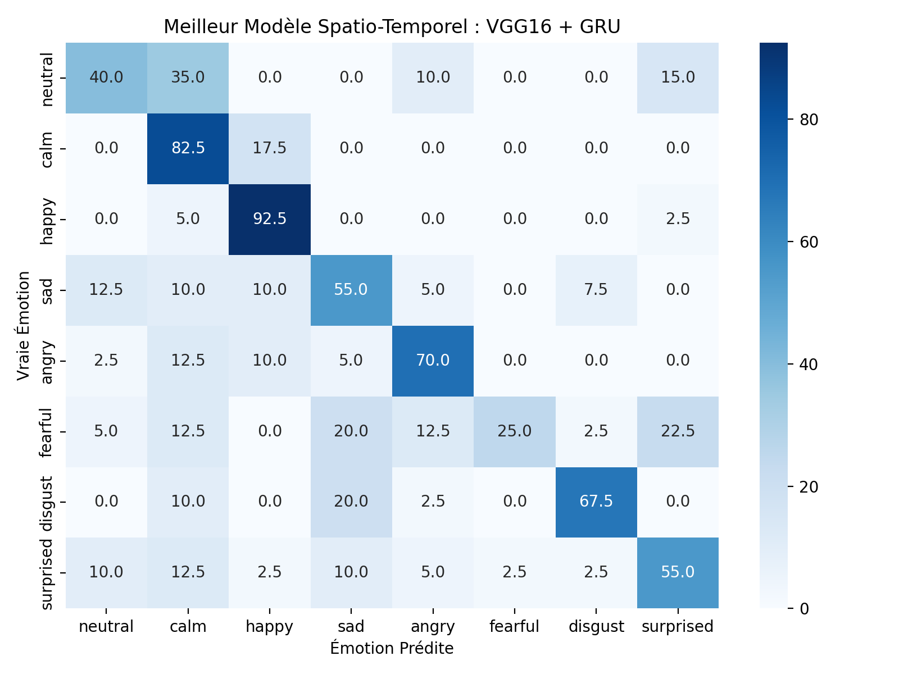
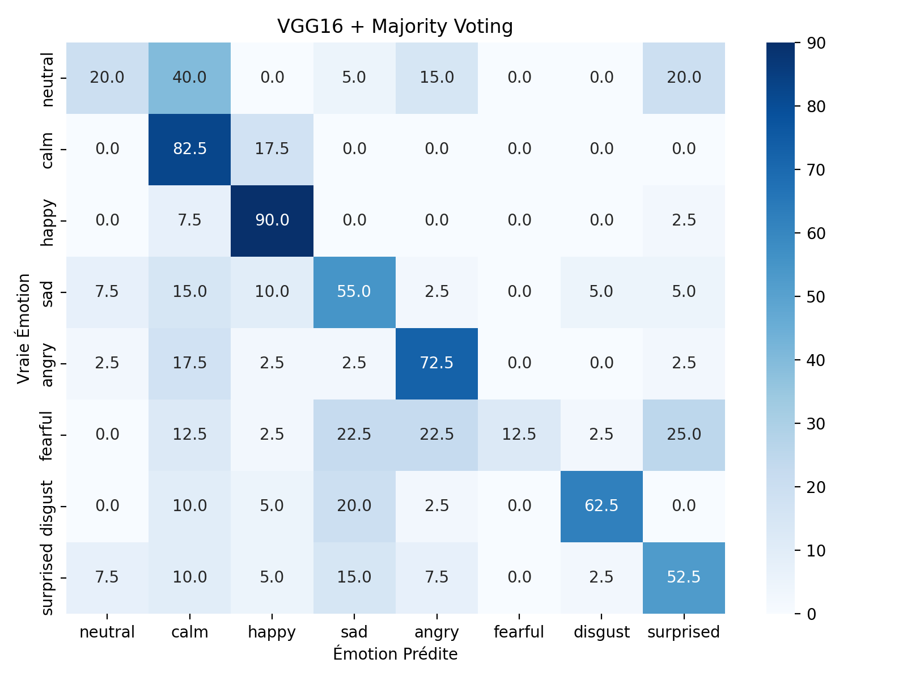

# 🎭 Reconnaissance d'Émotions Faciales sur Vidéo (RAVDESS) — Architecture Hybride Spatio-Temporelle

Ce projet implémente un pipeline complet de **reconnaissance d'émotions faciales à partir de séquences vidéo** (modalité visuelle uniquement) sur le jeu de données **RAVDESS** (*Ryerson Audio-Visual Database of Emotional Speech and Song*).

L'objectif principal est de démontrer l'apport de la modélisation temporelle (**RNN, LSTM, GRU, Transformer**) par rapport à une approche purement spatiale (**VGG16** image par image et vote majoritaire), sous un protocole d'évaluation strict **Actor-Independent** (aucun chevauchement d'acteurs entre l'entraînement et la validation).

---

## 🏗️ Architecture du Pipeline en 2 Étapes (Two-Stage Hybrid Pipeline)

1. **Prétraitement & Extraction de Keyframes (`src/dataset_parser.py`, `src/keyframe_selector.py`) :**
   * Extraction uniforme de **16 images clés (*keyframes*)** par vidéo, recadrées sur le visage et redimensionnées en `128 × 128 × 3`.
   * Classification sur les **8 émotions** du dataset RAVDESS : `neutral`, `calm`, `happy`, `sad`, `angry`, `fearful`, `disgust`, `surprised`[cite: 2].

2. **Stage 1 — Extracteur Spatial (`src/spatial_extractor.py`) :**
   * Fine-tuning d'un réseau convolutif **VGG16** pré-entraîné pour extraire des représentations spatiales discriminantes à partir de chaque frame individuelle.
   * Évaluation de référence par **Vote Majoritaire (*Majority Voting*)** sur les 16 frames de chaque vidéo.

3. **Stage 2 — Modélisation Séquentielle (`src/sequence_models.py`) :**
   * Extraction des vecteurs de caractéristiques latents pour chaque séquence de 16 frames.
   * Entraînement et comparaison de quatre architectures séquentielles à armes égales avec régularisation avancée (*Feature Dropout* `p=0.3`, bruit gaussien `0.05`, `weight_decay=1e-4`, `label_smoothing=0.1`) :
     * **VGG16 + RNN**
     * **VGG16 + LSTM**
     * **VGG16 + GRU**
     * **VGG16 + Transformer Encoder**

---

## 🧪 Protocole d'Évaluation (*Actor-Independent*)

Afin de garantir une réelle capacité de généralisation sur de nouveaux visages jamais vus à l'entraînement :
* **Ensemble d'entraînement (Train) :** Acteurs `01` à `19` (1 140 vidéos).
* **Ensemble de validation (Validation) :** Acteurs `20` à `24` (300 vidéos inédites).

---

## 📊 Résultats Comparatifs (Acteurs 20–24)

Les métriques complètes sont également disponibles dans le fichier [`results/benchmark_results.csv`](results/benchmark_results.csv)[cite: 7].

| Modèle (Architecture) | Accuracy (%) | F1-Macro (%) | Precision (%) | Recall (%) |
| :--- | :---: | :---: | :---: | :---: |
| **🏆 VGG16 + GRU (Meilleur Modèle)** | **62.33%** | **59.71%** | **64.84%** | **60.94%** |
| **VGG16 + Transformer** | 61.33% | 59.40% | 63.88% | 60.63% |
| **VGG16 + LSTM** | 60.33% | 57.84% | 63.64% | 58.75% |
| **VGG16 + RNN** | 60.33% | 57.56% | 63.32% | 59.06% |

### 🔍 Analyse des Performances
* **Supériorité de `VGG16 + GRU` :** L'architecture **GRU** obtient les meilleurs scores sur l'ensemble des métriques (**62.33 % d'Accuracy** et **59.71 % de F1-Macro**)[cite: 2]. Son mécanisme à deux portes (*reset* et *update*) capture efficacement la dynamique temporelle des expressions faciales sur 16 frames sans sur-paramétrer le modèle.
* **Analyse par émotion :** Les expressions à forte signature visuelle comme **`happy` (92.5 %)**, **`calm` (82.5 %)**, **`angry` (70.0 %)** et **`disgust` (67.5 %)** sont très bien reconnues[cite: 2]. Les principales confusions concernent des émotions visuellement proches en l'absence du signal audio (`neutral` vs `calm`, et `fearful` vs `surprised`)[cite: 2].

---

## 📈 Matrices de Confusion

### 1. Meilleur Modèle Spatio-Temporel : `VGG16 + GRU`


### 2. Référence Spatiale : `VGG16 + Majority Voting`


---

## 💾 Modèles Pré-entraînés & Cache Google Drive

En raison de la limite de taille des fichiers sur GitHub, les poids entraînés PyTorch (`.pth`) ainsi que les séquences latentes extraites (`.npy`) sont hébergés sur Google Drive[cite: 6] :

👉 **[Télécharger les poids pré-entraînés et le cache (`RAVDESS_cache`)](https://drive.google.com/drive/folders/1IJmvKI47iA6ikUNQ5xC9-DpCYdb7z5UO?usp=sharing)**

Contenu du dossier partagé :
* `best_spatial_vgg16.pth` — Poids du modèle spatial Stage 1 (VGG16)[cite: 6]
* `best_vgg16_gru.pth` — Poids du meilleur modèle spatio-temporel (**62.33 % Accuracy**)[cite: 2, 6]
* `best_vgg16_transformer.pth` — Poids du modèle VGG16 + Transformer[cite: 6]
* `best_vgg16_lstm.pth` — Poids du modèle VGG16 + LSTM[cite: 6]
* `best_vgg16_rnn.pth` — Poids du modèle VGG16 + RNN[cite: 6]

---

## 📂 Structure du Dépôt

```text
├── configs/
│   └── config.yaml                  # Configuration des hyperparamètres et chemins
├── notebooks/
│   └── Main_Pipeline_Colab.ipynb    # Notebook complet exécuté sur Google Colab (GPU)
├── report/                          # Documents et supports de présentation
├── results/
│   ├── benchmark_results.csv        # Tableau récapitulatif des métriques
│   ├── cm_best_spatiotemporal.png   # Matrice de confusion du modèle VGG16 + GRU
│   └── cm_majority_voting.png       # Matrice de confusion du vote majoritaire
├── src/
│   ├── dataset_parser.py            # Parsing des métadonnées RAVDESS et split par acteur
│   ├── keyframe_selector.py         # Extraction et prétraitement des 16 frames clés
│   ├── spatial_extractor.py         # Architecture CNN spatiale (VGG16)
│   ├── sequence_models.py           # Architectures temporelles (RNN, LSTM, GRU, Transformer)
│   └── evaluate.py                  # Calcul des métriques et tracé des matrices de confusion
├── .gitignore
├── README.md
└── requirements.txt